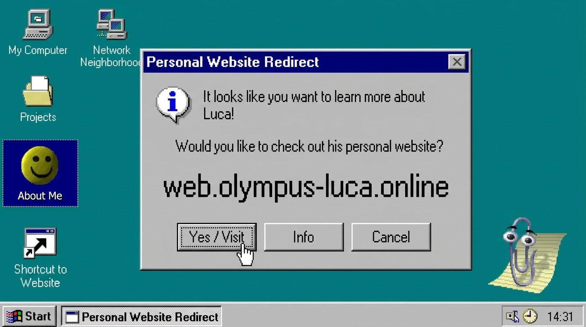
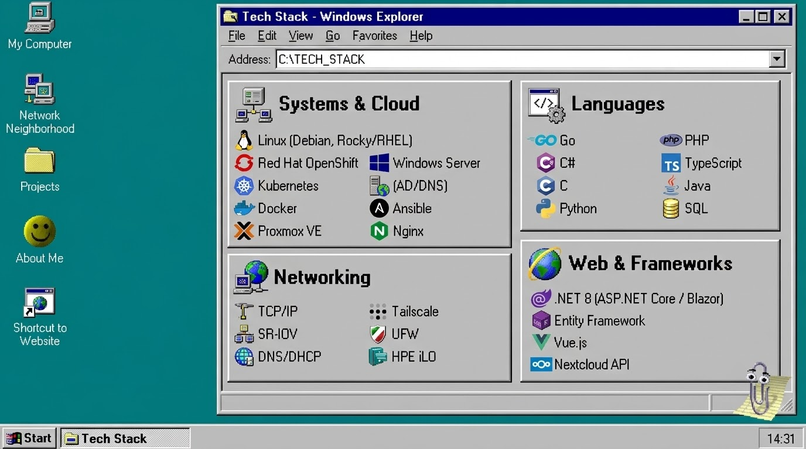

### Hi, I'm Luca-Adrian Mihuț (• ◡•)

**Computer Science & IT Student @ UPT** · **Software & Cloud Infrastructure**

I'm a Computer Science student at the Politehnica University of Timișoara passionate about software engineering, Linux systems, and cloud infrastructure. I enjoy building full-stack applications, automating workflows, and managing bare-metal and virtualized environments in my homelab.

- 🧑🏻‍💻 **Recent Experience:** 
  - **Cloud AI RAN Intern @ Nokia** — Deployed containerized edge workloads (vCU/vDU) on Red Hat OpenShift (OCP/SNO), executed bare-metal bring-up via HPE iLO, and administered Rocky Linux & SR-IOV networking.
  - **Software Engineering Intern @ Netrom** — Built full-stack web applications using C#, .NET 8 (Blazor Server), EF Core, and Leaflet JS.
- 🪴 **Currently working on:** Expanding my multi-node Proxmox homelab and developing a Nextcloud timekeeping plugin for university faculty + studying for the CCNA exam.
- 📄 **Resume:** [View my CV](https://lukettoooo.github.io/cv/CV_Luca_Mihut.pdf?v=20260918)
- ✉️ **Contact:** [mihut.luca@yahoo.com](mailto:mihut.luca@yahoo.com) · [LinkedIn](https://www.linkedin.com/in/luca-mihut)

---

### Tech Stack

- **Systems & Cloud:** Linux (Debian, Rocky/RHEL), Red Hat OpenShift (OCP/SNO), Kubernetes, Docker, Proxmox VE, Windows Server (AD/DNS), Ansible, Nginx
- **Networking:** TCP/IP, SR-IOV, DNS/DHCP, Tailscale, UFW, HPE iLO
- **Languages:** Go, C#, C, Python, PHP, TypeScript, Java, SQL
- **Web & Frameworks:** .NET 8 (ASP.NET Core / Blazor), Entity Framework, Vue.js, Nextcloud API

  

---

### 💽 Selected Projects

- **[Home Lab](https://github.com/lukettoOoO/homelab)** — Multi-node environment running Debian and Proxmox VE. Hosts Dockerized services (Nextcloud, GitLab, Netdata), a Windows Server 2022 VM (Active Directory/DNS), Nginx reverse proxy, and Tailscale.
- **[EcoMeal](https://github.com/lukettoOoO/EcoMeal)** — Full-stack web platform built with ASP.NET Core Blazor (.NET 8), EF Core, and OpenStreetMap/Leaflet JS for interactive mapping and live order concurrency.
- **[Nextcloud Staff Timekeeping Plugin](https://github.com/lukettoOoO/DCTI-Staff-Timekeeping-App)** — Custom Nextcloud app automating university faculty timekeeping with a PHP timetable parsing engine and a Vue.js frontend.
- **[Multi-threaded TCP Chat System](https://github.com/lukettoOoO/TCP-client-server-chat-system)** — Concurrent chat server and `ncurses` CLI client in C using POSIX threads and a custom binary protocol with checksum validation.
- **[Custom 16-bit Processor](https://github.com/lukettoOoO/General-Purpose-16bit-Processor) & [Nand2Tetris](https://github.com/lukettoOoO/Nand2tetris)** — Complete hardware-software stacks built from the ground up in Verilog and HDL, including custom ISAs, assemblers, and virtual machines.
